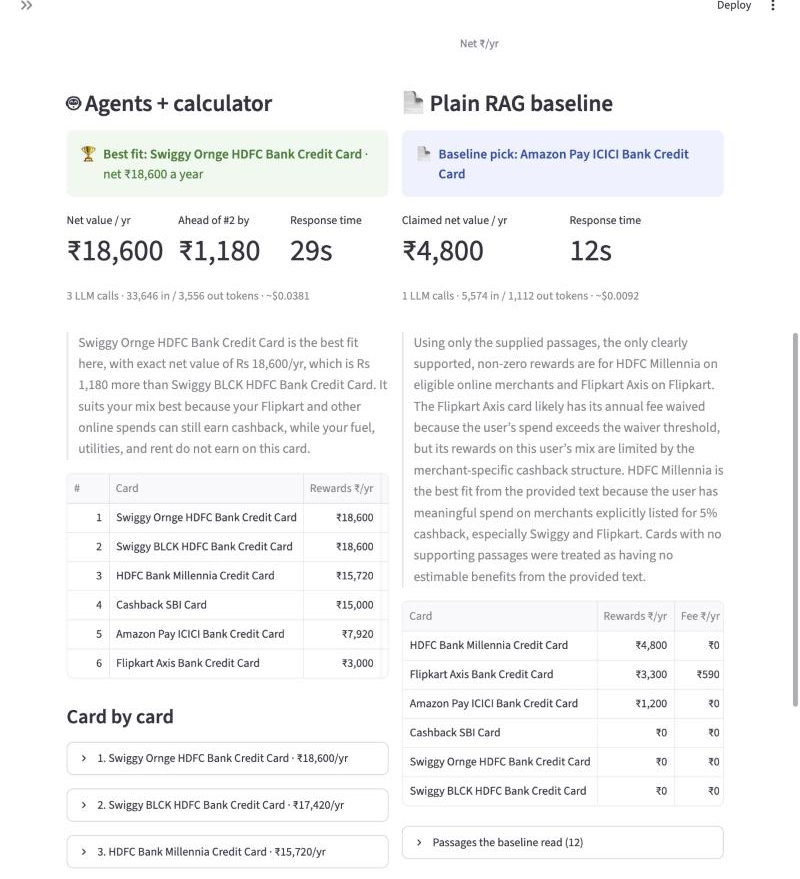
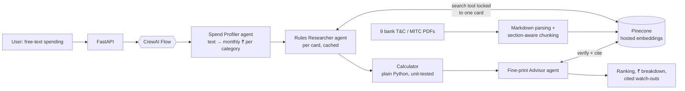
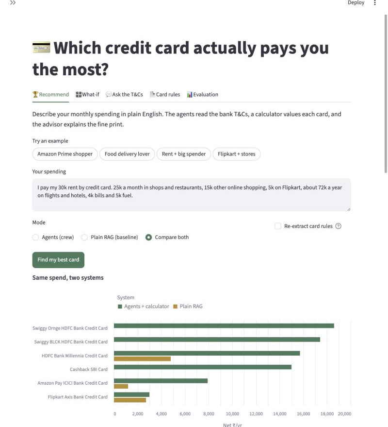
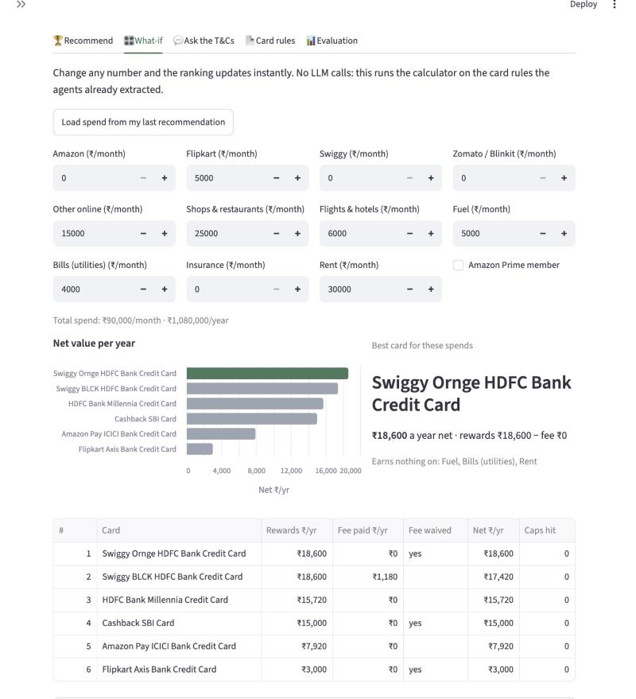
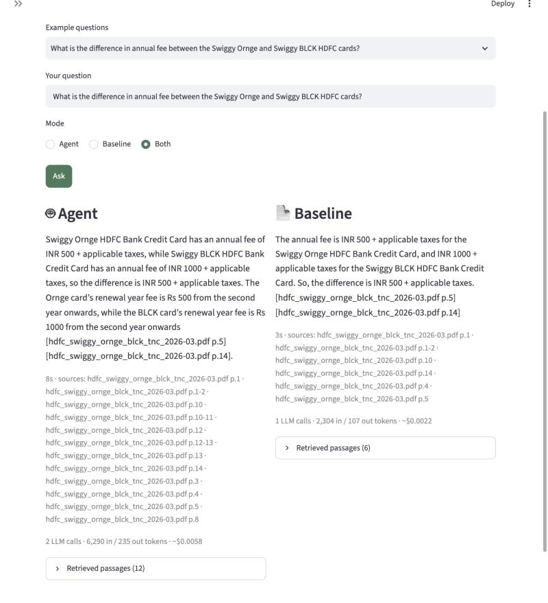
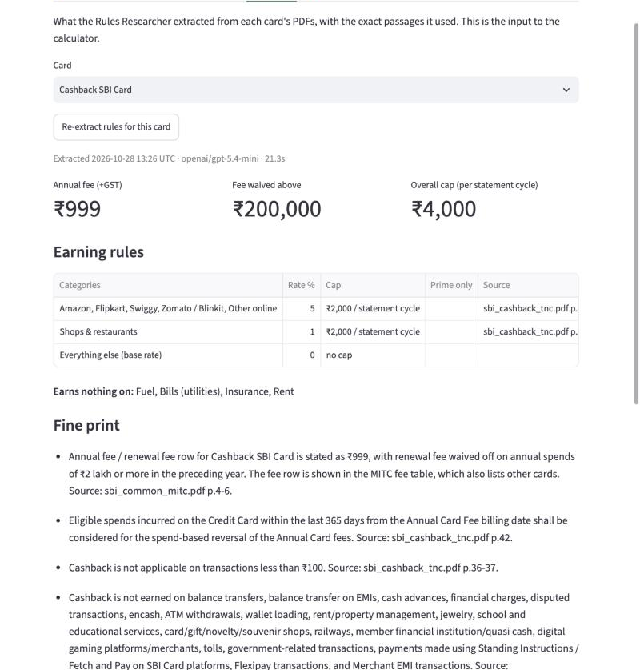
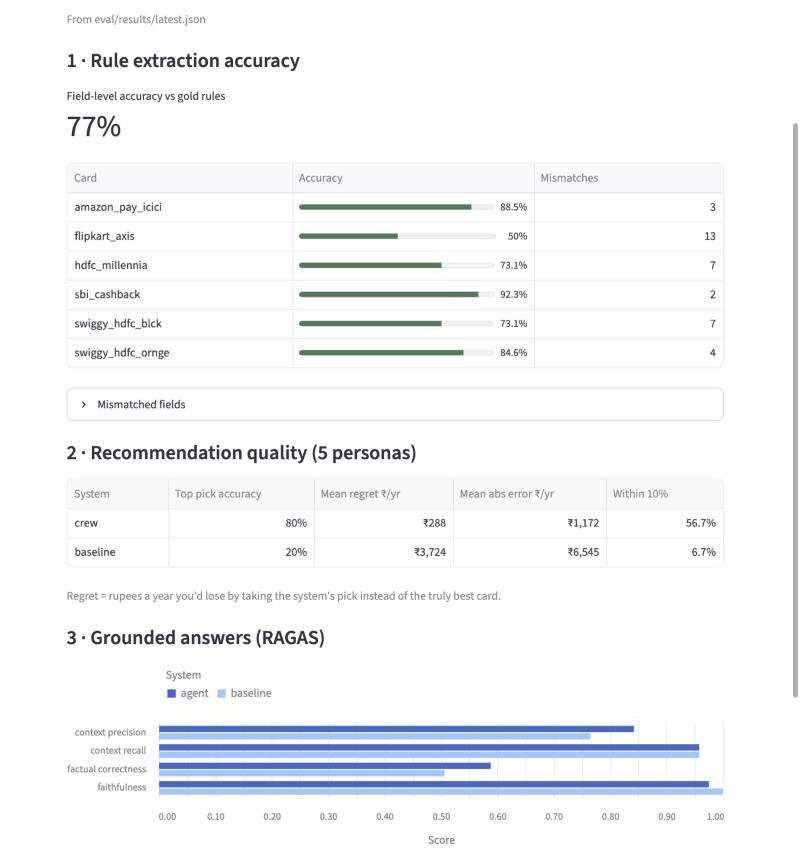

# Credit Card Fit Advisor

**Agentic RAG over real Indian bank T&C PDFs: which credit card actually pays *you* the most?**

You describe your spending in plain English. AI agents read the official bank documents and extract each
card's reward rules, with page citations. A deterministic calculator works out what every card is
worth to you in rupees, and an advisor agent explains the fine print that affects you.

**Stack:** CrewAI (Flow + tool-using agents) · Pinecone (serverless, hosted embeddings) · FastAPI · Streamlit ·
RAGAS · OpenAI GPT-5.4 mini (Gemini also supported) · PyMuPDF / pymupdf4llm · Pydantic



| Result (final version, v3) | Agentic pipeline | Plain RAG baseline |
|---|---|---|
| Rupee error per card per year | **₹1,172** | ₹6,545 |
| Best card picked correctly | **80%** | 20% |
| Estimates within 10% of the truth | **57%** | 7% |
| RAGAS context recall | 0.96 | 0.96 |

Same model, same documents and same test customers for both systems. All numbers are measured against
hand-verified rules, as described in [How it's evaluated](#how-its-evaluated).

---

## Why this is a hard problem

Card marketing says "5% cashback". The PDFs say: *5% on online spends, max ₹2,000 per statement cycle,
₹4,000 overall, nothing on rent, fuel, utilities, insurance or wallet loads, and from April 2026 also
nothing on gaming, tolls and government payments.* Picking the right card means:

1. finding the right rules across several PDFs per card (T&Cs, fee schedules, revision notices);
2. noticing when a **revision notice overrides** the original terms;
3. keeping card variants apart when **one PDF covers two cards** with different numbers;
4. reading **fee tables that list 40+ cards**, and tables whose cells span several rows;
5. doing the maths with caps, overall caps, exclusions, fee waivers and GST.

Plain RAG can retrieve the right passages and still get the answer wrong, because steps 2–5 are where
LLMs slip. The baseline in this repo shows it: one search, one LLM call, ₹6,545 average error per card.

## What I built



- **A deterministic workflow with agentic steps.** A CrewAI Flow runs fixed steps (profile → research →
  calculate → explain) with typed state. Agents are used only where judgement is needed: deciding what
  to search for and reading the results.
- **"LLMs extract, code calculates."** The Rules Researcher turns documents into structured, cited
  rules (Pydantic). A tested Python calculator does every rupee of arithmetic. The advisor explains
  the ranking but cannot change it; the top pick is enforced in code.
- **Retrieval guardrails in code, not in prompts.** The search tool is locked to one card's
  documents, so the agent physically can't read another card's numbers. Every chunk carries
  `doc_type` and `effective_date`, so the agent can apply "the newer revision wins".
- **Structure-aware ingestion.** PDFs become Markdown (pymupdf4llm). Chunks follow the document's own
  headings, tables are never cut mid-row (big tables split between rows with the header repeated), merged
  table cells are restored using PyMuPDF's table detection, and each section is tagged with the card it describes.
- **Rules cached per card.** A card's rules don't depend on the user, so the expensive extraction runs
  once. After that, a recommendation is about two LLM calls, and the What-if tab revalues any spend
  instantly with zero LLM calls.
- **Auditable by design.** Every passage an agent retrieves is logged. The UI shows the exact page each
  rule came from, and API responses report token usage and cost.

## How it's evaluated

Three layers, each answering a different question, always against a plain-RAG baseline on the same model:

| Suite | Question | Metric |
|---|---|---|
| Extraction | Did the agent read the PDFs correctly? | Field-level accuracy of 156 facts (fee, waiver, rate and cap per category, for 6 cards) against hand-verified gold rules |
| Recommendation | Does the user get the right card? | Top-pick accuracy, **regret** (₹/yr lost vs the truly best card), ₹ error per card, share within 10% |
| Grounded Q&A | Are answers supported by the documents? | RAGAS: faithfulness, context recall, context precision, factual correctness |

The "true" rupee values come from running the **same calculator on the gold rules**, so the recommendation
suite measures rule understanding only. Every run is tagged and records its model, chunker, prompt version
and cost. I wrote a prediction of what should change before each run.

## Results: four benchmarked versions

| Version | What changed | Extraction | ₹ error / card | Top pick | RAGAS recall (agent / baseline) |
|---|---|---|---|---|---|
| v1 | PyMuPDF text, 180-word page windows | 74.4% | ₹2,040 | 40% | 0.83 / 0.71 |
| v2 | Markdown, section-aware, table-preserving, card-scoped chunks | 69.2% | ₹2,102 | 60%* | 0.96 / 1.00 |
| v2.1 | + merged table cells restored | 66% | ₹2,189 | 60%* | 0.96 / 0.96 |
| **v3** | + prompt rules for the recurring reasoning slips | **77%** | **₹1,172** | **80%** | 0.96 / 0.96 |

\* Not counted as a gain. The over-valued card just moved from one card to another, and the ₹ error didn't improve.

**What the experiments showed:**
1. **Better chunking fixed retrieval, not reasoning.** Context recall went from 0.83 to 0.96, and
   table-row errors disappeared (a fee had been read from the neighbouring card's row). It also introduced
   a new failure: Markdown loses merged cells, so a cap shared by four rows showed on only one row.
   I found it by diffing results field by field and fixed it in v2.1.
2. **Most remaining errors were reasoning slips on passages the agent already had**, such as "1% on
   other spends" not treated as the base rate, or categories excluded that the documents never exclude.
   Six generic prompt rules plus a verification search round fixed 22 fields, broke 5, and halved the ₹ error.
3. **Small evaluation sets are noisy.** A single extraction run swung individual cards by 20 points on
   unchanged inputs. So I only claim a gain when several metrics move together, and I log why.

Every issue, its cause, the fix and its measured effect is in the
**[Engineering log](ENGINEERING_LOG.md)** (24 entries plus a conclusion).

## The app

The spend in these screenshots is test persona p3: rent, shops, online, travel. By the hand-checked rules
the best card is Swiggy Ornge, worth ₹19,080 a year. The agents pick it and value it at ₹18,600. The
plain-RAG baseline finds evidence for only three cards and picks Amazon Pay ICICI, which is worth ₹6,120:
₹12,960 a year less.

| Recommend: describe your spending, compare both systems | Agents vs plain RAG on the same spend |
|---|---|
|  |  |
| **What-if: instant revaluation, no LLM calls** | **Ask the T&Cs: cited answers, agent vs baseline** |
|  |  |
| **Card rules: what the agent extracted, with sources** | **Evaluation: the latest benchmark in the UI** |
|  |  |

- **Recommend:** free-text spending → best card, net ₹/year per card, per-category breakdown, caps hit and
  cited watch-outs. Can run agents, baseline, or both side by side.
- **What-if:** edit any monthly spend and the ranking updates instantly (calculator + cached rules).
- **Ask the T&Cs:** questions about card terms, with sources and the retrieved passages.
- **Card rules:** the extracted rules per card, the exact passages behind them, and a re-extract button.
- **Evaluation:** extraction accuracy, recommendation quality and RAGAS scores from the latest run.

## What this project demonstrates

- **Agentic RAG with CrewAI:** a Flow with typed state, role-based agents, a custom tool with
  code-level access control, and structured Pydantic outputs.
- **Retrieval engineering on messy PDFs:** Markdown parsing, section- and table-aware chunking,
  merged-cell repair, metadata filtering, revision-aware metadata, multi-card documents.
- **Evaluation:** gold data, custom business metrics (regret in ₹), RAGAS, a baseline on the same
  model, experiment tagging, predictions written before each run, and reading noisy results honestly.
- **Production habits:** a FastAPI service with a thin UI client; retries, timeouts and rate limiting;
  per-call token and cost tracking; caching; unit tests for the calculator and the chunker; an engineering log.

## Limitations and next steps

- Results are single runs per version (no error bars), and the v3 prompt rules were written and tested on the same 6 cards.
- The same model answers and judges in RAGAS; switching to an independent judge (Gemini) is one setting.
- Search is dense-only. Next: hybrid dense + keyword search for exact card names and codes, and a reranker.
- Two documents are missing from the corpus (HDFC Millennia's fee page, Flipkart Axis's full T&C), which caps accuracy for those cards.
- It runs locally. Next: containerised deployment, rules in a database, and the eval suite as a CI gate.

## Repository guide

| Read this | For |
|---|---|
| [ENGINEERING_LOG.md](ENGINEERING_LOG.md) | Every issue → cause → fix → result, the experiment tracker and the conclusion |
| [PROJECT_UNDERSTANDING.md](PROJECT_UNDERSTANDING.md) | A full technical walkthrough: flow, chunking, retrieval, agents, API, evaluation design |
| [docs/SETUP.md](docs/SETUP.md) | Setup, keys, PDFs, running the app and reproducing the benchmarks |

```
app/    ingestion, chunking, retrieval, agents + Flow, calculator, baseline, FastAPI
ui/     Streamlit front end (talks to the API only)
eval/   gold rules, personas, questions, the three suites, RAGAS judge, results per version
tests/  calculator and chunker unit tests
```

**Quick start:** `pip install -r requirements.txt`, add your Pinecone and OpenAI keys to `.env`, put the
PDFs in `data/pdfs/`, then run `python -m app.ingest --reset`, `uvicorn app.main:app` and
`streamlit run ui/app.py`. Details in [docs/SETUP.md](docs/SETUP.md).


